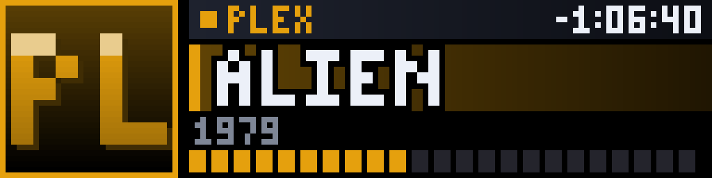
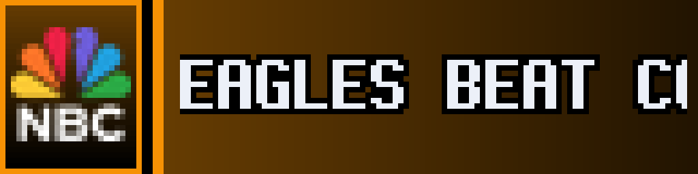
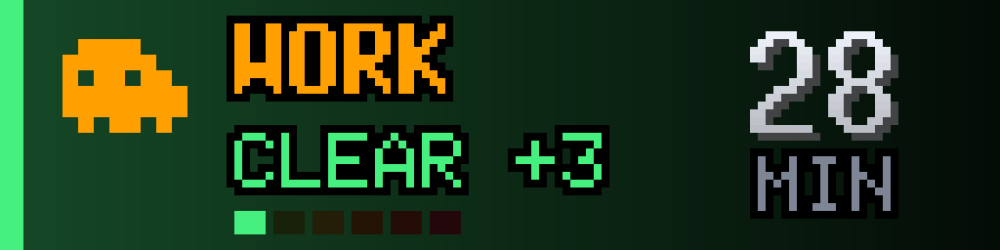
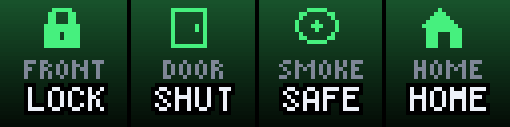
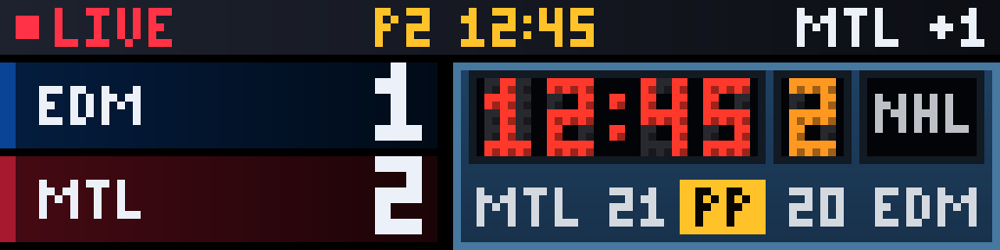
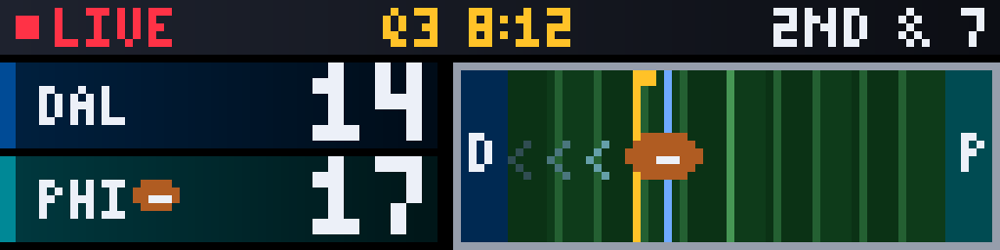

# LEDMatrix arcade plugins

Eleven plugins for a 128x32 RGB [LEDMatrix](https://github.com/ChuckBuilds/LEDMatrix) panel, all drawn in the same arcade style: big pixel type, status gradients, bursts and confetti. Each folder is a self-contained plugin. Copy it to `~/LEDMatrix/plugin-repos/<name>`, add its block to `config/config.json`, and restart.

Every screenshot below is a real frame from the plugin's own renderer.

## [media-marquee](media-marquee/)

**Everything that plays in your house, as a glowing arcade marquee.**

Press play on Plex and your panel turns into a movie-theatre marquee: the show's banner art, fetched from TMDB and Fanart.tv, scrolls across the glass the moment the stream starts. Fire up YouTube TV, Netflix or Spotify and it switches to a slick now-playing card with the service's colour, the title, a live countdown and a segmented progress bar. When nothing is playing, the panel waits like a cabinet in an arcade: **INSERT COIN**.

[Details and more screenshots](media-marquee/)

## [news-arcade](news-arcade/)

**Your news feeds, crawling across the panel like a game's high-score ticker.**

One headline at a time, full height, in big smooth pixel type on a gradient the colour of the feed. Long headlines rest, crawl to the end once, then rest again, so you can always read the whole thing. Each feed gets its own logo tile (NBC, ESPN, or two-letter initials) so you know the source at a glance.

[Details and more screenshots](news-arcade/)

## [waze-travel](waze-travel/)

**Your commute as a traffic light: how long it takes, and how bad it is.**

A big number, the word MIN, and a verdict. The drive-time screen compares your live time against free-flow traffic and colours the whole panel to match: green CLEAR, orange HEAVY, red JAM, with the minutes of delay (+26) beside it, a little car sprite, a trend arrow, and a segmented bar that fills as traffic builds.

[Details and more screenshots](waze-travel/)

## [ha-notifications](ha-notifications/)

**Home Assistant alerts that take over the panel and demand to be read.**

Send a message from Home Assistant and the whole panel erupts: a rays-and-flash splash for the severity, then the message crawls across a full-height gradient card with a pixel-art icon. Critical alerts blink a red border until they are dealt with. When nothing is happening the panel idles on a calm **ALL QUIET**.

[Details and more screenshots](ha-notifications/)

## [print-monitor](print-monitor/)

**A progress screen for your 3D printer that you can read from across the room.**

Start a print on your Bambu Lab printer and the panel wakes up: the job's cover image on the left, a huge percentage, time remaining and the ETA clock, nozzle and bed temperatures, layer count, and a progress gauge in the actual filament colour. Pause for a filament run-out and it tells you why. When the print finishes, confetti.

[Details and more screenshots](print-monitor/)

## [house-hud](house-hud/)

**The whole house on one screen, as four glowing arcade tiles.**

Front door locked? Smoke alarms quiet? Is everyone home? Four 32-pixel tiles answer it at a glance: green for fine, orange for take a look, red and blinking for alarm. A second screen shows inside and outside temperature, how many lights are on, and the hot tub. Screens take turns on a timer.

[Details and more screenshots](house-hud/)

## [sky-weather](sky-weather/)

**A weather display that follows the sky: real sunrises, sunsets and the Moon.**

The backdrop is the actual sky over your house. It runs from deep night through a pink dawn, a blue day and an orange golden hour to a violet dusk, coloured by where the sun really is. The sun rides an arc between today's sunrise and sunset, and the Moon rides its own, with its true phase, its maria and the tilt it has from your latitude: an evening crescent leans toward the sunset.

[Details and more screenshots](sky-weather/)

## [hot-tub](hot-tub/)

**A live window into the hot tub, with real water.**

The temperature in big digits, a status light, and an animated cross-section of the tub: calm blue water that ripples when the bubbles are on, a heater flame while it heats, and a bold FAULT screen if something goes wrong. When it reaches temperature, a **READY! GET IN** burst tells you without you checking a thing.

[Details and more screenshots](hot-tub/)

## [nhl-live-ice](nhl-live-ice/)

**NHL night, on a scoreboard that looks like the arena's.**

An LED arena scoreboard with a glowing clock, shots on goal and power-play flags, plus collectible trading-card player cards with headshots, rarity tiers (COMMON to LEGENDARY) and the stat line of the night. Every goal fires a GO-AHEAD! or GOAL burst with the scorer's face. Recent games show the final with the top performers; upcoming games show a matchup preview with the line.

[Details and more screenshots](nhl-live-ice/)

## [nfl-live-field](nfl-live-field/)

**NFL Sunday, with an animated field and a touchdown burst.**

The live game plays out on a tiny football field: the ball sits at the yard line, the first-down marker glows, the arrows point the way. Stats cards show the quarterback's line with a headshot and a rarity tier, and a scoring play erupts in a TOUCHDOWN! burst with the passer, the receiver and the play.

[Details and more screenshots](nfl-live-field/)

## [nba-live-court](nba-live-court/)

**NBA night on an LED arena scoreboard, with a burst for every big run.**

The game clock glows red, the quarter glows amber, and each team's record sits where the fouls would be, all in LED dots on a blue arena board, exactly like the hockey one. When a team strings together six unanswered points, the logo box lights gold and a tag counts the run (9-0); at eight it puts a flame on the score. Player cards show the night's best line with a headshot, and a LEAD CHANGE! burst fires when the lead flips late. The CLUTCH tag lights up in close fourth quarters.

[Details and more screenshots](nba-live-court/)

---

Never commit `config.json`: it holds Home Assistant, Plex, TMDB and Fanart tokens. Each plugin's `example_config.json` uses placeholders.
