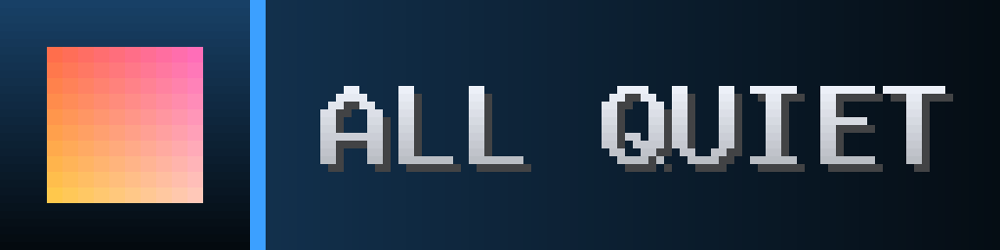

# HA Notifications — LEDMatrix Plugin

<!-- hero -->
**Home Assistant alerts that take over the panel and demand to be read.**

Send a message from Home Assistant and the whole panel erupts: a rays-and-flash splash for the severity, then the message crawls across a full-height gradient card with a pixel-art icon. Critical alerts blink a red border until they are dealt with. When nothing is happening the panel idles on a calm **ALL QUIET**.

Notifications arrive over MQTT or an HTTP webhook, with LaMetric-style icons and a `/frame.png` endpoint for a live preview. It ships with the automations that power the house's smoke and carbon-monoxide alarms (see `ha-automation-backups`).

- Severities from info to critical, each with its own colour and splash
- Crawling message in a large readable face, no header or footer
- Pixel-art and LaMetric icons
- MQTT and webhook, running together
- Smoke and CO automations that repeat until the air clears
- Idle ALL QUIET screen

<p align="center"><br><sub>Critical splash</sub></p>
<p align="center"><br><sub>Smoke detector</sub></p>
<p align="center"><br><sub>Warning splash</sub></p>
<p align="center"><br><sub>Success</sub></p>
<p align="center"><br><sub>A message with a tick icon</sub></p>
<p align="center"><br><sub>Idle: ALL QUIET</sub></p>

*Screenshots are real frames from the plugin's renderer, shown 8x on a 128x32 panel.*
<!-- /hero -->

A [LEDMatrix](https://github.com/ChuckBuilds/LEDMatrix) plugin that displays Home Assistant notifications on your RGB LED matrix in real time.

Supports **HTTP webhooks** and **MQTT** simultaneously. Notifications show with pixel-art icons, severity-colored headers, and smooth scrolling text.

---

## What it looks like

128 x 32 panel, arcade style (same family as the NBA / NFL / NHL Live plugins):

- **Splash**: a new notification interrupts whatever is showing with a flash, a spinning sunburst and the severity word (`ALERT!`, `WARNING!`, `SUCCESS!`, `INFO`, `NEW`) for about a second.
- **Card** (`icon_left`): icon tile on a severity-coloured gradient and the **message in big letters** on a full-height gradient row. A message that does not fit rests, crawls to its end once, rests again, so it is always read in full, then the card clears. A `critical` card blinks a red border. No header or footer: the severity shows in the colour, the splash and the border. The title is not drawn when there is a message (it is still in the payload); with no message the title becomes the big line.
- **`text_only`**: the same card without the tile.
- **`icon_only`**: a sunburst behind a big pulsing icon, for alarms.
- **Idle**: the HA logo and ALL QUIET.

`GET /frame.png` on the webhook port (`http://<PI_IP>:5006/frame.png`) shows the panel's current notification frame upscaled; it only looks and never changes the queue.

Options: `crawl_speed` (45 px/s), `min_seconds` (6), `max_seconds` (25), `splash`, `message_font` (9x15B / 8x13B / 7x13B / 6x10). `scroll_speed_ms` from v1 is no longer used.

---

## Installation

### 1. Copy plugin into LEDMatrix

```bash
cd ~/LEDMatrix/plugin-repos
git clone https://github.com/YOUR_USERNAME/ledmatrix-ha-notifications.git ha-notifications
```

### 2. Install dependencies

```bash
pip3 install paho-mqtt flask --break-system-packages
```

> **Tip:** Install these manually *before* first start. If LEDMatrix tries to
> install them itself during plugin load it can occasionally time out on
> slower Pis, which prevents the plugin from loading on the first boot.

### 3. Add to `config/config.json`

```json
"ha-notifications": {
  "enabled": true,
  "display_duration": 15,
  "live_priority": true,

  "webhook_enabled": true,
  "webhook_port": 5006,
  "webhook_secret": "your-secret-token-here",

  "mqtt_enabled": false,
  "mqtt_host": "192.168.0.x",
  "mqtt_port": 1883,
  "mqtt_topic": "ledmatrix/notify",
  "mqtt_username": "",
  "mqtt_password": ""
}
```

### 4. Restart LEDMatrix

```bash
sudo systemctl restart ledmatrix
```

---

## Home Assistant Setup

### Option A — HTTP Webhook

Add to `configuration.yaml`:

```yaml
rest_command:
  matrix_notify:
    url: "http://<PI_IP>:5006/notify"
    method: POST
    headers:
      Content-Type: application/json
      X-Matrix-Token: "your-secret-token-here"
    payload: >-
      {"title": "{{ title }}",
       "message": "{{ message }}",
       "severity": "{{ severity | default('default') }}",
       "icon_name": "{{ icon_name | default('') }}"}
```

Use in automations:

```yaml
- alias: "Matrix — Front Door"
  trigger:
    platform: state
    entity_id: binary_sensor.front_door
    to: "on"
  action:
    service: rest_command.matrix_notify
    data:
      title: "Front Door"
      message: "Opened at {{ now().strftime('%I:%M %p') }}"
      severity: warning
      icon_name: door
```

### Option B — MQTT

Set `mqtt_enabled: true` in config, then publish from any HA automation:

```yaml
action:
  service: mqtt.publish
  data:
    topic: "ledmatrix/notify"
    payload: >-
      {"title": "Front Door",
       "message": "Opened at {{ now().strftime('%I:%M %p') }}",
       "severity": "warning",
       "icon_name": "door"}
```

No `rest_command` needed — cleaner automations, instant delivery.

---

## Notification Payload

| Field | Type | Required | Description |
|-------|------|----------|-------------|
| `title` | string | ✅ | Header bar text (max 40 chars) |
| `message` | string | | Scrolling body text (max 200 chars) |
| `severity` | string | | `default` `info` `warning` `critical` `success` |
| `icon_name` | string | | Named pixel-art icon (see below) |
| `icon_color` | array | | RGB tint override e.g. `[255, 140, 0]` |
| `layout` | string | | `auto` `text_only` `icon_left` `icon_only` |
| `ttl` | int | | Seconds until expiry (default 3600) |

---

## Available Icons

| Icon | Use for |
|------|---------|
| `door` | Door open/close |
| `motion` | Motion detection |
| `lock` | Lock/unlock |
| `fire` | Smoke/fire alarm |
| `water` | Water/flood sensor |
| `thermometer` | Temperature alerts |
| `bell` | Doorbell / general alert |
| `check` | Task complete |
| `warning` | General warning |
| `camera` | Camera motion |
| `person` | Presence detection |
| `home` | Home/away mode |
| `car` | Garage / vehicle |
| `power` | Power outage / UPS |
| `music` | Media playing |
| `light` | Light on/off |

Query available icons at runtime:
```bash
curl http://<PI_IP>:5006/icons
```

---

## LaMetric Icons (full color + animated GIF)

In addition to the built-in pixel-art icons above, `icon_name` also accepts a
[LaMetric icon gallery](https://developer.lametric.com/icons) ID — no account
or API key needed. These render in **full color**, and animated icons play
as actual animated GIFs on the matrix.

```json
{"title": "Front Door", "message": "Opened", "icon_name": "lametric:8149"}
```

Accepted formats: `lametric:8149`, `lm:8149`, or a bare numeric string like
`"8149"`.

- Browse icons and grab the numeric ID from https://developer.lametric.com/icons
- **Preview an ID before using it:** `http://<PI_IP>:5006/lametric/preview?id=8149` renders
  it straight in your browser (upscaled, real color, animated if the icon is a GIF) — handy
  for checking it looks right before wiring the ID into an automation.
- Icons are fetched once, then cached forever at
  `~/.cache/ledmatrix-ha-notifications/lametric_icons/` — later uses of the
  same ID are instant, no network round-trip.
- Static icons render as a single frame; animated ones (`type: "movie"` in
  LaMetric's gallery) cycle through their real frame timing automatically.
- Icons are pulled at their native size and scaled up with nearest-neighbor
  (no blur) to match the matrix's pixel-art look.

---

## Severity Colors

| Value | Color | Use for |
|-------|-------|---------|
| `default` | Cyan | General info |
| `info` | Green | Status updates |
| `warning` | Amber | Attention needed |
| `critical` | Red | Urgent alerts |
| `success` | Bright green | Completed actions |

---

## Configuration Options

| Option | Type | Default | Description |
|--------|------|---------|-------------|
| `enabled` | bool | `true` | Enable/disable plugin |
| `display_duration` | number | `15` | Seconds per notification |
| `scroll_speed_ms` | number | `40` | Scroll step delay (lower = faster) |
| `max_queue` | int | `10` | Max queued notifications |
| `live_priority` | bool | `true` | Jump to front of rotation on new notification |
| `webhook_enabled` | bool | `true` | Enable HTTP webhook server |
| `webhook_port` | int | `5006` | Webhook listen port |
| `webhook_secret` | string | `""` | Auth token (X-Matrix-Token header) |
| `mqtt_enabled` | bool | `false` | Enable MQTT subscriber |
| `mqtt_host` | string | `localhost` | Broker IP or hostname |
| `mqtt_port` | int | `1883` | Broker port |
| `mqtt_topic` | string | `ledmatrix/notify` | Subscribe topic |
| `mqtt_username` | string | `""` | Broker username (if required) |
| `mqtt_password` | string | `""` | Broker password (if required) |

---

## API Endpoints

| Endpoint | Method | Auth | Description |
|----------|--------|------|-------------|
| `/notify` | POST | Token | Send a notification |
| `/status` | GET | None | Health check + queue size |
| `/icons` | GET | None | List available icon names |

---

## Test Without HA

```bash
curl -X POST http://<PI_IP>:5006/notify \
  -H 'Content-Type: application/json' \
  -H 'X-Matrix-Token: your-secret-token-here' \
  -d '{"title":"Test","message":"Hello from curl!","severity":"success","icon_name":"check"}'
```

---

## License

GPL-3.0 — same as the [LEDMatrix](https://github.com/ChuckBuilds/LEDMatrix) project.
