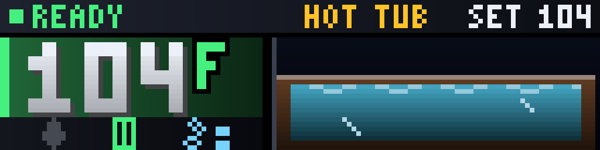
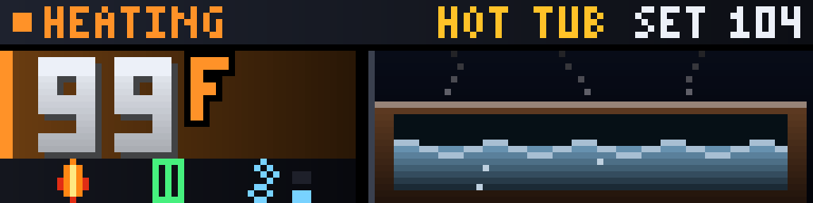
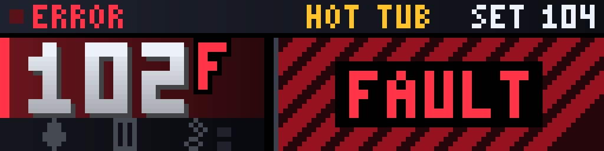

# Hot Tub

<!-- hero -->
**A live window into the hot tub, with real water.**

The temperature in big digits, a status light, and an animated cross-section of the tub: calm blue water that ripples when the bubbles are on, a heater flame while it heats, and a bold FAULT screen if something goes wrong. When it reaches temperature, a **READY! GET IN** burst tells you without you checking a thing.

It reads the spa's state from Home Assistant over MQTT and shares the arcade font and drawing kit with the NFL and NBA plugins.

- READY, HEATING, ERROR, OFF and NO DATA states
- Current and set temperature
- Heater, filter and bubbles indicators
- Animated water
- READY burst when the tub hits temperature

<p align="center"><br><sub>Ready to soak</sub></p>
<p align="center"><br><sub>Heating</sub></p>
<p align="center"><br><sub>Fault</sub></p>
<p align="center"><br><sub>The READY! burst</sub></p>

*Screenshots are real frames from the plugin's renderer, shown 8x on a 128x32 panel.*
<!-- /hero -->

Live hot tub status on the LED matrix, fed from Home Assistant over MQTT, drawn in
the same arcade style as the NBA Live Court and NFL Live Field plugins (it shares
their 3x5 pixel font and drawing kit).

## The screens

| Screen | What it shows | When |
|--------|---------------|------|
| **Tub** | Header band with a status light (blinks while heating), the status word and the set point. A gradient panel in the status color with the water temperature in arcade numerals. Heater flame, filter cartridge and jets (with a two-step gauge) light when active and dim when off. On the right, a cross-section of the tub: the water **rises as it approaches the set point** (it spans the last 10 degrees), with a live wave, bubbles rising when the jets run (more on high) and steam wisps while heating | Always |
| **Fault** | Hazard stripes and a blinking FAULT where the tub scene would be, when the spa reports an error | `errors` is true |
| **Burst** | Spinning green sunburst, confetti and `READY!` with the temperature, for 6 seconds | The moment a heat-up reaches temperature (never on the first reading after a restart) |
| **No data** | Dashes and a blinking NO DATA until the first MQTT message arrives | Before the first message |

Colors: green READY (within 1 degree of target), amber HEATING, red ERROR, grey OFF /
OFFLINE / STALE, white IDLE, yellow NO DATA.

## Install

Copy the folder to the Pi and restart:

```bash
scp -r hot-tub pi@raspberrypi.local:~/LEDMatrix/plugin-repos/
sudo systemctl restart ledmatrix ledmatrix-web
```

Then enable it and set the MQTT details in the web UI, or directly in
`~/LEDMatrix/config/config.json`:

```json
"hot-tub": {
  "enabled": true,
  "mqtt_host": "homeassistant.local",
  "mqtt_port": 1883,
  "mqtt_topic": "ledmatrix/hottub",
  "mqtt_username": "YOUR_MQTT_USER",
  "mqtt_password": "YOUR_MQTT_PASSWORD",
  "display_duration": 15
}
```

## Home Assistant side

Home Assistant does not publish entity states to MQTT on its own, so
one automation pushes a snapshot whenever anything changes. Add this
under Settings → Automations → Edit in YAML.

Adjust the entity IDs if yours differ.

```yaml
alias: Publish hot tub status to LED matrix
description: Sends a hot tub snapshot to the matrix whenever anything changes
trigger:
  - platform: state
    entity_id:
      - climate.hot_tub_spa_thermostat
      - switch.hot_tub_spa_power
      - switch.hot_tub_spa_filter
      - select.hot_tub_spa_bubbles
      - binary_sensor.hot_tub_spa_connected
      - binary_sensor.hot_tub_spa_errors
  # Also republish periodically so the matrix can tell a quiet spa
  # from a dead feed.
  - platform: time_pattern
    minutes: "/5"
mode: queued
max_exceeded: silent
action:
  - service: mqtt.publish
    data:
      topic: ledmatrix/hottub
      retain: true
      payload: >-
        {{
          {
            "current_temp": state_attr('climate.hot_tub_spa_thermostat', 'current_temperature'),
            "target_temp":  state_attr('climate.hot_tub_spa_thermostat', 'temperature'),
            "unit": "F",
            "power":     states('switch.hot_tub_spa_power'),
            "heater":    state_attr('climate.hot_tub_spa_thermostat', 'hvac_action'),
            "filter":    states('switch.hot_tub_spa_filter'),
            "bubbles":   states('select.hot_tub_spa_bubbles'),
            "connected": is_state('binary_sensor.hot_tub_spa_connected', 'on'),
            "errors":    is_state('binary_sensor.hot_tub_spa_errors', 'on')
          } | to_json
        }}
```

`retain: true` matters — it means the matrix gets current values the
moment it connects, instead of showing "NO DATA" until the spa next
changes state.

## Checking it

Watch the topic from the Pi:

```bash
mosquitto_sub -h homeassistant.local -u YOUR_USER -P YOUR_PASS -t 'ledmatrix/hottub' -v
```

Trigger the automation manually in HA and confirm a JSON payload
arrives. If it does but the display still says NO DATA, the plugin
isn't reaching the broker:

```bash
sudo journalctl -u ledmatrix -n 50 --no-pager | grep -i "hot tub\|hot-tub"
```

Startup logs the broker and topic it subscribed to.

## Payload

Every field is optional; anything missing shows as a dash rather than
breaking the display.

| Field | Meaning |
|---|---|
| `current_temp` | Current water temperature |
| `target_temp` | Thermostat setpoint |
| `unit` | `F` or `C` (display only, no conversion) |
| `power` | Spa power switch |
| `heater` | `heating`, `idle`, or `off` |
| `filter` | Filter pump state |
| `bubbles` | Bubbles/jets state |
| `connected` | Whether HA can reach the spa |
| `errors` | Whether the spa reports a fault |

If no message arrives for 15 minutes the display shows STALE, so a
silently dead feed doesn't masquerade as a current reading.
