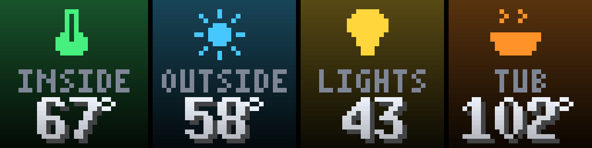
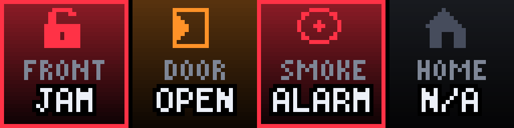
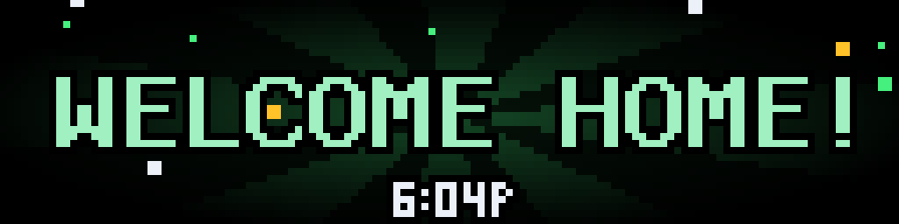

# House HUD (arcade)

<!-- hero -->
**The whole house on one screen, as four glowing arcade tiles.**

Front door locked? Smoke alarms quiet? Is everyone home? Four 32-pixel tiles answer it at a glance: green for fine, orange for take a look, red and blinking for alarm. A second screen shows inside and outside temperature, how many lights are on, and the hot tub. Screens take turns on a timer.

When something happens, the HUD does not wait for its turn: the front door unlocking, opening, locking, or you arriving home each take over the panel with a big burst (WELCOME HOME!) and the time. It reads everything from Home Assistant with one template call every five seconds, and every tile is configurable.

- Tile types: lock, door or window, smoke, presence, temperature, count
- Status colours and blinking alarm borders
- Event bursts with on-demand interrupt
- Entity ids validated before they reach the template
- Fully configurable screens
- Built-in `test_mode` demo day

<p align="center"><br><sub>Security screen</sub></p>
<p align="center"><br><sub>Climate screen</sub></p>
<p align="center"><br><sub>Problems light up red</sub></p>
<p align="center"><br><sub>Event: front door unlocked</sub></p>
<p align="center"><br><sub>Event: you arrive home</sub></p>

*Screenshots are real frames from the plugin's renderer, shown 8x on a 128x32 panel.*
<!-- /hero -->

A game-style status screen for the house on a 128x32 LEDMatrix panel, read from Home Assistant. Four 32px tiles per screen, screens taking turns every `page_seconds`:

```
 FRONT   DOOR   SMOKE   HOME        INSIDE  OUTSIDE  LIGHTS   TUB
 [lock]  [door] [alarm] [house]     [therm] [sun]    [bulb]   [tub]
  LOCK    SHUT    SAFE    HOME        67°     58°      43      102°
```

Each tile is a status-coloured gradient (green fine, orange needs a look, red alarm) with a pixel icon, a label and one value. Alarms and jams blink a red border. No header, no footer.

**Events.** When the front door opens or unlocks (or locks again), or you arrive home, a burst takes over the panel for `event_seconds`: UNLOCKED!, LOCKED!, OPENED!, WELCOME HOME!, with the time. An event interrupts the rotation straight away (`interrupt`, the same on-demand switch `ha-notifications` uses). The first poll after a start never bursts, and a sensor coming back from `unavailable` is not an event. A door closing is quiet.

Smoke and CO *alerts* stay with `ha-notifications` and its HA automations; the HUD only shows the SMOKE tile (blinking ALARM while any detector is on).

## Tiles

| type | reads | shows |
|------|-------|-------|
| `lock` | a lock entity | LOCK (green) / OPEN (orange) / JAM (red, blinking) |
| `opening` | a door or window binary_sensor | SHUT (green) / OPEN (orange) |
| `safe` | `entities`: alarm binary_sensors | SAFE / ALARM when any is on / N/A when all are unavailable |
| `presence` | a person or device_tracker | HOME / AWAY |
| `temp` | a temperature state, or `attr` (e.g. a climate's `current_temperature`) | the number with a degree ring, coloured by how warm it is |
| `count` | `domain` + `state` | how many entities of that domain are in that state (lights on) |

Anything unavailable shows a dim N/A. Up to four tiles per screen; `icon` is optional (`thermo`, `sun`, `tub`, `bulb`, `house`, `smoke`, `door`, `lock`).

## Setup

One call to Home Assistant's template API per poll (every 5 s) reads every tile. Entity ids are validated before they go into the template.

```json
"house-hud": {
  "enabled": true,
  "display_duration": 14,
  "ha_url": "http://homeassistant.local:8123",
  "ha_token": "your-long-lived-token"
}
```

With no `screens`, the defaults are used (this house: `lock.front_door`, `binary_sensor.front_door_sensor`, the five smoke alarms, `person.your_name`, the Nest, OpenWeatherMap, lights on, the hot tub). Example custom screen:

```json
"screens": [{"tiles": [
  {"type": "lock", "entity": "lock.front_door", "label": "FRONT"},
  {"type": "opening", "entity": "binary_sensor.garage_door", "label": "GARAGE"},
  {"type": "temp", "entity": "sensor.basement_temperature", "label": "CELLAR", "icon": "thermo"}
]}]
```

`test_mode: true` plays a made-up day (door opens, front door unlocks and locks, smoke blips, you come home) without polling; turn it off afterwards. Display mode: `house_hud`.

Files: `manager.py` (plugin and polling thread), `hud_data.py` (template, tile logic, events), `hud_render.py` (screens and icons), `hud_draw.py` / `hud_font.py` (shared arcade kit), `bdf_face.py` (BDF fonts).
