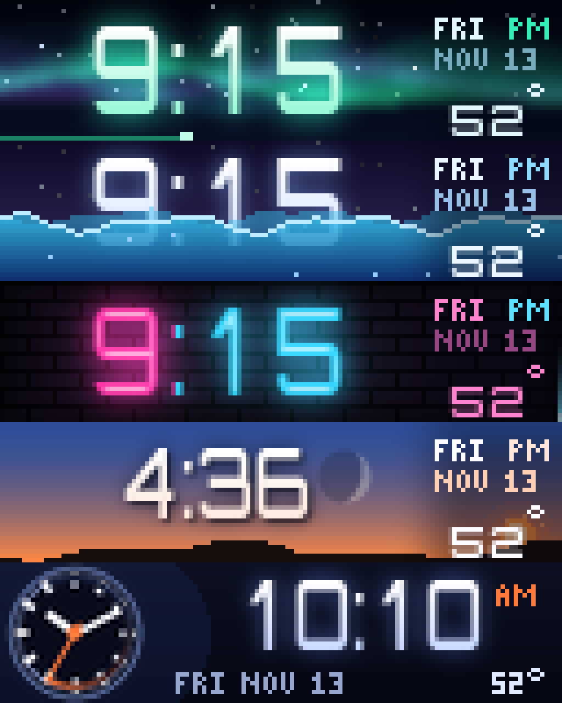
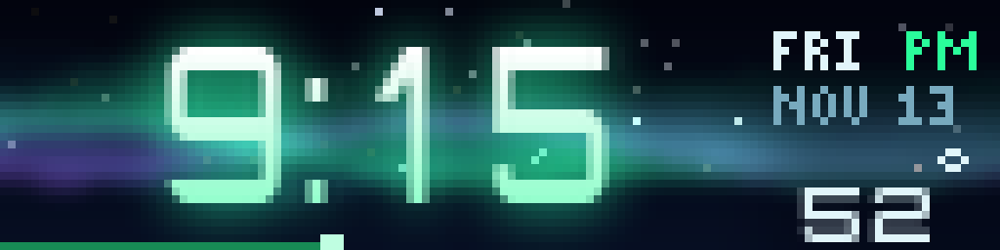
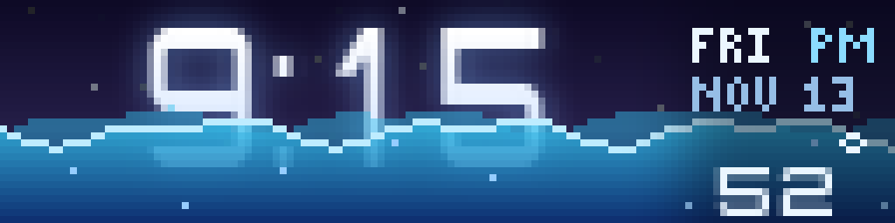
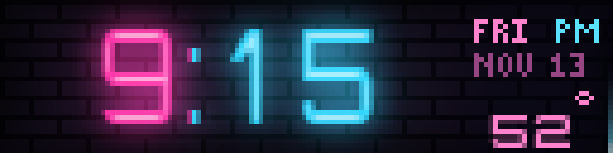
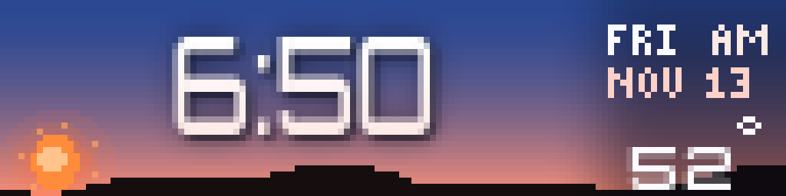
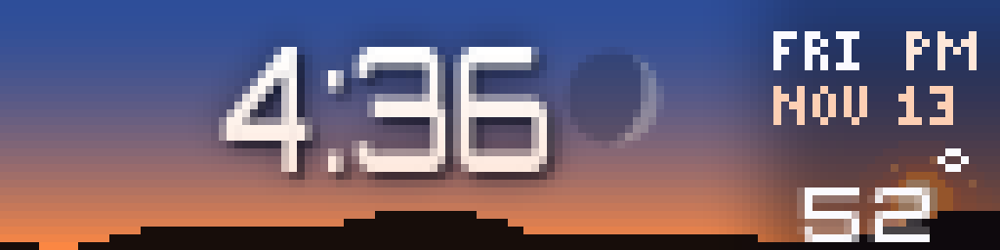
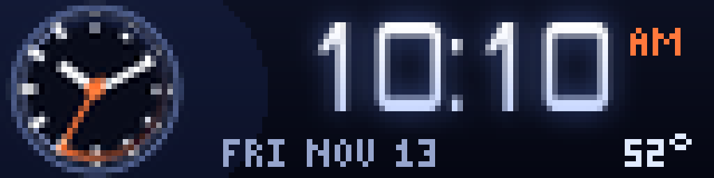
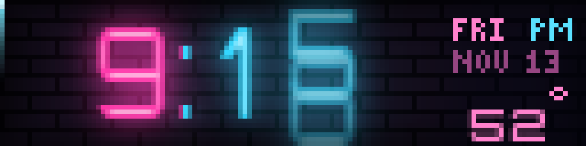
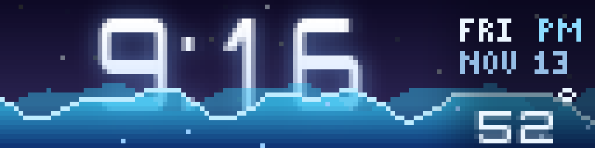

# Lumen Clock

<!-- hero -->
**A clock made to be looked at: soft glowing digits over aurora, tide, neon, real sky and a sweeping dial.**

The time is set in large, smooth digits that roll over when they change: the old digit slides up and fades while the new one rises from below. Behind it, five scenes take turns, one each time the clock comes round in your rotation. Northern lights flow in three drifting curtains over twinkling stars. Water rises with the seconds and drains at the top of the minute. Neon tubes glow on a brick wall while a comet circles the panel once a minute. And the real sky for your location rolls from night through dawn, day, golden hour and dusk, with the sun on its arc and the Moon in its true phase.

A quiet column holds the weekday, AM/PM, the date and the outdoor temperature from Home Assistant. The clock runs on the Pi's own time and never waits on the network, redraws in 10 to 20 ms, and has a test mode that runs time faster so you can watch a whole day go by.

- Five scenes: aurora, tide, neon, daylight (real sky and Moon) and orbit (analog dial)
- Smooth antialiased digits that roll over when they change
- The seconds shown as light: a thread, a rising tide, a comet, a sweeping hand
- Daylight scene follows the real sun, with the Moon's true phase and tilt for your location
- Optional outdoor temperature from Home Assistant
- 12 or 24 hour time; pin one scene or cycle through them
- Fast: 10 to 20 ms per frame on a Raspberry Pi
- Built-in `test_mode` that runs time faster

<p align="center"><br><sub>The five scenes</sub></p>
<p align="center"><br><sub>Aurora</sub></p>
<p align="center"><br><sub>Tide: the water rises with the seconds</sub></p>
<p align="center"><br><sub>Neon</sub></p>
<p align="center"><br><sub>Daylight at sunrise</sub></p>
<p align="center"><br><sub>Daylight at golden hour, with the Moon</sub></p>
<p align="center"><br><sub>Orbit: an analog dial beside the digital time</sub></p>
<p align="center"><br><sub>A digit rolling over</sub></p>
<p align="center"><br><sub>The tide draining at the top of the minute</sub></p>

*Screenshots are real frames from the plugin's renderer, shown 8x on a 128x32 panel.*
<!-- /hero -->

A clock for a 128x32 LEDMatrix panel that is meant to be looked at. The time is set in large, soft, antialiased digits that roll over when they change, over five scenes that take turns: each time the clock comes round in your rotation it shows the next one.

## Scenes

| scene | what it does |
|-------|--------------|
| `aurora` | Northern lights flow behind the time in three drifting curtains of green, teal and violet, over twinkling stars. A bright thread along the foot of the panel fills through the minute |
| `tide` | Water rises with the seconds, with a darker wave behind the front one, bubbles climbing to the surface and a bright crest. At the top of the minute it drains with a ripple. The digits are partly submerged as the level climbs |
| `neon` | Glowing tubes on a dim brick wall: hours in hot pink, minutes in cyan, a bright core in each stroke, a colon that breathes once a second and a tube that stutters now and then. A comet runs once round the edge of the panel every minute |
| `daylight` | The real sky for your location behind the time: the colour follows the sun from night through dawn, day, golden hour and dusk; the sun rides its arc between today's sunrise and sunset; the Moon shows its true phase and tilt; stars come out at night; hills along the bottom |
| `orbit` | A smooth analog dial with hour and minute hands and a sweeping second hand with a comet tail, beside the digital time |

Every scene has a quiet column on the right with the weekday, AM/PM, the date and (optionally) the outdoor temperature. Each appearance fades up from black, and digits roll over: the old one slides up and fades while the new one rises from below.

## Setup

```json
"lumen-clock": {
  "enabled": true,
  "display_duration": 20,
  "style": "cycle",
  "time_format": "12h",
  "ha_url": "http://homeassistant.local:8123",
  "ha_token": "your-long-lived-token",
  "weather_entity": "weather.openweathermap"
}
```

* The clock runs on the Pi's own time and never waits on the network. Home Assistant is optional: it provides the outdoor temperature (`show_temperature`) and, for the `daylight` scene, where you are (latitude, longitude and time zone). Without it, set `latitude`, `longitude` and `timezone` yourself, or leave them out and the `daylight` scene is skipped.
* `style` is `cycle` or one scene to pin. `scenes` picks which scenes take part in the cycle, in order.
* `time_format` is `12h` or `24h`. `show_seconds` turns the seconds-as-light (thread, tide, comet, hand) off.
* `test_mode: true` runs time `demo_speed` times faster (default 90) and steps through every scene for nine seconds each, so you can watch a whole day go by. Turn it off afterwards. Display mode: `lumen_clock`.

## Typeface

The digits use Orbitron (SIL Open Font License), which LEDMatrix already ships in `assets/fonts`, squeezed sideways so they can be tall and slim. The plugin looks for it in its own `fonts` folder, then the core's, then falls back to DejaVu Sans Bold and finally Pillow's built-in face. No font file is bundled here.

## Performance

Frames take about 10 to 20 ms on a Raspberry Pi: masks for steady digits and their glows are built once and reused, and light is mixed with C-speed image operations rather than per-pixel Python.

Files: `manager.py` (plugin), `lumen_scenes.py` (the five scenes), `lumen_type.py` (typeface, rolling digits, glow), `lumen_sky.py` (sun, Moon and stars for `daylight`), `lumen_astro.py` (sun and Moon maths), `lumen_data.py` (optional Home Assistant calls), `lumen_draw.py` / `lumen_font.py` (drawing kit), `bdf_face.py`. Tests: `test_lumen.py`.
