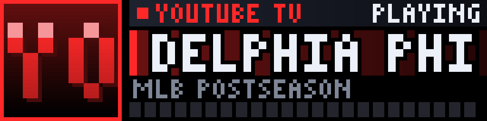

# Media Marquee

<!-- hero -->
**Everything that plays in your house, as a glowing arcade marquee.**

Press play on Plex and your panel turns into a movie-theatre marquee: the show's banner art, fetched from TMDB and Fanart.tv, scrolls across the glass the moment the stream starts. Fire up YouTube TV, Netflix or Spotify and it switches to a slick now-playing card with the service's colour, the title, a live countdown and a segmented progress bar. When nothing is playing, the panel waits like a cabinet in an arcade: **INSERT COIN**.

It replaces `plex-marquee` and `now-playing` with a single plugin, polls Home Assistant for your media players, and does all of its network work in background threads so the display never stutters. A built-in web portal lets you search and pin banners, manage service icons and watch a live preview of the panel.

- Plex banners from TMDB + Fanart.tv, matched by title and year
- Streaming info screens for YouTube TV, Netflix, Spotify and more, with service colour and icon
- PLAYING / PAUSED for sources with no timeline instead of a fake clock
- NOW PLAYING burst when something new starts
- INSERT COIN idle screen
- Web portal: live preview, banner picker, icon and GIF library

 Plex: title, year and progress

 Netflix: episode and countdown

 YouTube TV: no timeline, so PLAYING

 Spotify

 The NOW PLAYING burst

 Idle: INSERT COIN

*Screenshots are real frames from the plugin's renderer, shown 8x on a 128x32 panel.*
<!-- /hero -->

One LEDMatrix plugin for everything that plays: Plex banners, streaming apps, music, and an idle banner rotation.
Replaces `plex-marquee` + `now-playing`.

| What is playing | What the panel shows |
|---|---|
| Plex video (TMDB match) | Fanart.tv banner for `banner_seconds`, then an info card with the poster for `info_seconds` |
| Anything with player art (music, native Plex entity) | Info card with that art and a small service badge |
| YouTube TV / Netflix / Disney+ ... | LaMetric service icon (or your uploaded icon/GIF), title, time remaining, segmented progress bar |
| Nothing | Rotating banners: the ones you curate in the portal, else recently added on Plex |

Only Plex titles are looked up on TMDB, so other apps can never pull in the banner of a show you don't own.

## Web portal  (`http://<pi>:5010`, set `portal_port`)

- **Live** – the plugin's own current frame, what it thinks is playing, and the state of every player.
- **Banners** – search Plex, pick any Fanart.tv banner, reorder / disable / remove. A picked banner is also used whenever that title plays.
- **Icons & GIFs** – per-service icon override (PNG/GIF/JPG) and full-screen GIF (used when there is no album/poster art).

The portal has no login, same as the other LEDMatrix plugin portals: keep it on your LAN.

## Setup

`python3 copy_config.py` builds the config block from your existing `plex-marquee` one (credentials are copied, never printed).
`entity_services` maps players that report no `app_name`, e.g. `{"media_player.philcofinal": "spotify"}`.
See `config_schema.json` for every option.
