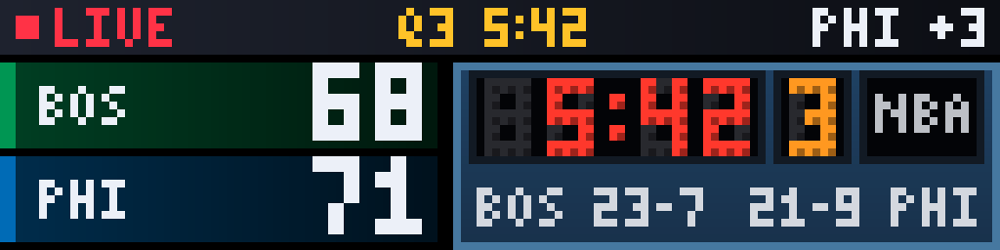
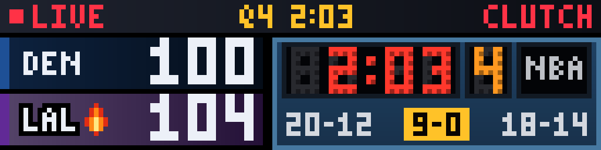
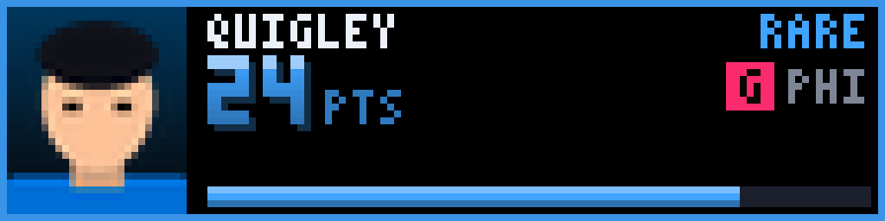
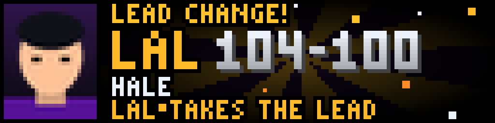
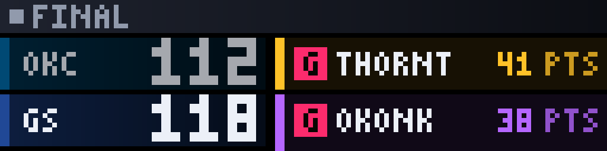
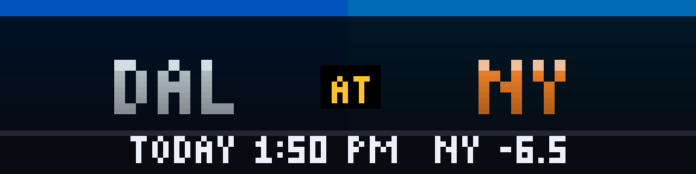

# NBA Live Court

<!-- hero -->
**NBA night on an LED arena scoreboard, with a burst for every big run.**

The game clock glows red, the quarter glows amber, and each team's record sits where the fouls would be, all in LED dots on a blue arena board, exactly like the hockey one. When a team strings together six unanswered points, the logo box lights gold and a tag counts the run (9-0); at eight it puts a flame on the score. Player cards show the night's best line with a headshot, and a LEAD CHANGE! burst fires when the lead flips late. The CLUTCH tag lights up in close fourth quarters.

Live, recent and upcoming games have their own rotations, with favourites and lock-to-favourites.

- LED scoreboard: game clock, quarter (HALF at the break), records
- Gold run lamp with the points of a 6+ point run, flame at 8+
- Player cards: points, rebounds, assists, double-doubles
- Lead-change and run bursts
- Final scores with top performers
- Upcoming matchups with the spread

<p align="center"><br><sub>Live scoreboard</sub></p>
<p align="center"><br><sub>A 9-0 run lights the lamp</sub></p>
<p align="center"><br><sub>Player card</sub></p>
<p align="center"><br><sub>Lead change!</sub></p>
<p align="center"><br><sub>Final</sub></p>
<p align="center"><br><sub>Upcoming matchup</sub></p>

*Screenshots are real frames from the plugin's renderer, shown 8x on a 128x32 panel.*
<!-- /hero -->

An arcade-style NBA show for your LED scoreboard, built like Fantasy Blitz and
its sibling NFL Live Field: an LED arena scoreboard with quarter-by-quarter scores,
collectible player cards with real headshots, and a burst when a team goes on
a big run -- for **live**, **recent** (final score) and **upcoming** (matchup
preview) games, each its own rotation. A **favorites lock** limits all three to
your teams. No login or API key.

## The screens

| Screen | What it shows | When |
|--------|---------------|------|
| **Scoreboard** | Score rows in each team's colors beside an LED arena board: a red game clock, the quarter in amber (`HALF` at the break), each team's record and a logo box. The box's border and a gold tag (`9-0`) light up while a team is on a run of 6+ unanswered points, with the points each team scored in every quarter and the last play scrolling along the bottom. **CLUTCH** flashes in red in the last five minutes of the fourth quarter or overtime when it is a five-point game or closer. A flame sits on a team's score while it is on a run of 8+ | One per live game |
| **Player card** | A game leader as a trading card: ESPN headshot, name, position tag, count-up stat, the rest of the stat line (`14 REB 11 AST`) and an XP bar filling toward the next rarity. The frame color is the rarity: gold (Legendary), purple (Epic), blue (Rare). A player who leads several categories is **one** card, headlined by his best stat, with a `DBL-DBL` or `TRIPLE-DBL` badge when the numbers ESPN names earn it | After each game's scoreboard screen, `cards_per_game` of them |
| **Burst** | A spinning sunburst in the team's colors, confetti, the team, the new score and what happened (`LAL 9-0 RUN`, `LAL TAKES THE LEAD`). It interrupts the rotation for a few seconds | A **big run** (a team outscores the other by `alert_min_points`, default 8, between two updates) or a **lead change** in the fourth quarter or overtime |

Basketball scores every few seconds, so there is deliberately no burst per
basket; a favorite's burst would never stop. After a burst the scoring team's
row keeps pulsing on the scoreboard screen for a few seconds.

### Rarity

| | Legendary (gold) | Epic (purple) | Rare (blue) |
|-|------------------|---------------|-------------|
| Points | 40+ | 30+ | 20+ |
| Rebounds | 18+ | 14+ | 10+ |
| Assists | 14+ | 10+ | 7+ |

Anything lower is Common (white). Rarity rises during a game as the numbers do.

## Live, recent and upcoming

Three display modes, so the plugin fits into your rotation as three entries --
disable the ones you don't want from the plugin's mode list in the web UI,
independent of `show_recent` / `show_upcoming`.

| Mode | Shows | Screens |
|------|-------|---------|
| **Live** (`nba_live`) | Games in progress | Scoreboard, player cards, bursts |
| **Recent** (`nba_recent`) | Finished games | Score rows (the loser dimmed) + an animated stat-leader ticker where the board would be, quarter scores, plus player cards |
| **Upcoming** (`nba_upcoming`) | Games that haven't tipped off | Matchup, records, tip-off time (`TODAY 7:30 PM`, `TMRW 1:00 PM`) and the spread when ESPN has one |

## Favorites and the lock

* `favorite_teams` -- pick teams in the web UI (ESPN's abbreviations: `GS`, `NY`,
  `NO`, `SA`, `UTAH`, `WSH`, `PHX`...). Typed spellings like `GSW`, `NYK`, `WAS`
  are folded in. Favorites' games come first, get extra turns
  (`favorite_live_boost` live, `game_limits.favorite_rotation_boost` for
  recent/upcoming), and their players' cards lead.
* `lock_to_favorites` -- show **only** games involving a favorite, in every mode.
  If none of your teams is playing, the plugin shows nothing and the display
  moves straight on. `lock_fallback_to_all` shows every other live game until a
  favorite tips off.
* `exclude_teams` -- never show these teams anywhere (spoiler protection). Beats
  favorites and the lock.
* `spoiler_delay_seconds` -- hold everything back this many seconds, to match a
  delayed broadcast.

With no favorites chosen, every live game shows.

## Install on the Pi

```bash
cd ~/LEDMatrix/plugin-repos
unzip -o ~/nba-live-court.zip          # creates nba-live-court/
cd ~/LEDMatrix && pip install --break-system-packages -r plugin-repos/nba-live-court/requirements.txt
sudo systemctl restart ledmatrix
```

Then open the web UI, enable **NBA Live Court**, pick your teams, and add
`nba_live`, `nba_recent` and `nba_upcoming` to your rotation.

To see the look without waiting for a game, set **Advanced > Test mode**: six
made-up games (made-up players too), including a Lakers 9-0 run and lead change
every few updates, with no network use.

## How it gets its data

ESPN's public scoreboard, one request per day: **yesterday** (recent finals),
**today** and **tomorrow** (upcoming), in US Eastern -- ESPN rejects date ranges.
Today is refreshed every `advanced.live_poll_seconds` (30) while a game is on
or about to tip off, every `idle_poll_seconds` (600) otherwise; yesterday and
tomorrow every 15 minutes (yesterday every 30 seconds while one of its games is
still going, e.g. a late tip-off after midnight). Turning off `show_recent`
or `show_upcoming` skips that day's request. Player headshots come from ESPN
too, a few per update, stored in the plugin cache (not on disk).

If a fetch fails the last good copy is used, so a network blip never blanks the
display. `get_info()` (and the web UI's plugin info) shows `last_error`.

### What is real and what is decoration

* Real: scores, period, clock, quarter scores, records, spread, leaders, the
  last play when ESPN supplies one, the run (counted between updates).
* Decoration: the ball. ESPN's scoreboard has no ball position, so it dribbles
  and shoots at the basket of the team on a run, or alternates ends when
  nobody is on one.
* A run is counted from update to update, so a basket-for-basket trade inside
  one 30-second window shows as the net margin, never a longer run than
  happened. A restart or a long outage resets runs and queues no bursts.

## Panel sizes

Designed at 128x64 and 128x32 and checked at 64x32, 64x64, 96x48, 128x96,
192x64, 256x32 and 256x128. Narrow panels (under 96 px) stack the score rows;
wide ones (192+) put a player card beside the scoreboard; very large ones draw the
128x64 design at 2x.

## All settings

| Setting | Default | |
|---------|---------|-|
| `favorite_teams` | none | Teams to favor |
| `lock_to_favorites` / `lock_fallback_to_all` | off / off | See above |
| `live_game_duration` | 12 s | Court screen, per live game |
| `cards_per_game` / `card_seconds` | 2 / 6 s | Player cards after each court screen |
| `favorite_live_boost` | 2 | Turns a favorite's live game gets per lap |
| `live_priority` | on | Let a live game take over the rotation |
| `show_headshots` | on | Off draws a jersey-number silhouette instead |
| `score_alerts` | on | Bursts on or off |
| `alert_min_points` | 8 | Run size for a burst (0 = lead changes only) |
| `celebrate_all_teams` | off | Bursts for every team, not just favorites |
| `show_recent` / `recent_game_duration` / `recent_cards_per_game` | on / 10 s / 1 | Recent mode |
| `show_upcoming` / `upcoming_game_duration` | on / 8 s | Upcoming mode |
| `game_limits.*` | see UI | How many favorite / other recent and upcoming games, how often the "other" slice rotates |
| `spoiler_delay_seconds` / `exclude_teams` | 0 / none | Spoiler protection |
| `advanced.*` | | Poll rates, timeout, burst length, animation on/off and FPS, photo downloads, test mode |

## Troubleshooting

* **Nothing shows:** with the lock on and none of your teams playing, that is
  correct. Check `last_error` in the plugin info; with the lock off, any live
  game should show.
* **Cards but no photos:** photos arrive over the first few updates (at most
  four per update). Check `show_headshots` and `advanced.headshot_downloads`.
* **No cards at all on a game:** ESPN sometimes leaves leaders out for a few
  minutes around tip-off and after the final buzzer; the court screen still
  shows.
* **Logs:** `journalctl -u ledmatrix -f | grep -i "NBA"`.

## Development

```bash
pip install --break-system-packages pytest Pillow requests
python -m pytest -q          # 200+ tests: model, data, render, plugin
```

The tests run from a bare checkout (a stub stands in for the core's
`BasePlugin`). Module names are prefixed `nbalive_` so they can't collide with
other plugins loaded in the same process.

## License

GPL-3.0, like the rest of LEDMatrix.
