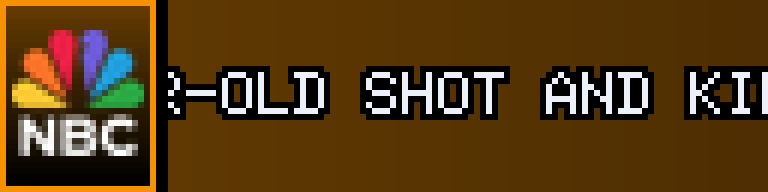
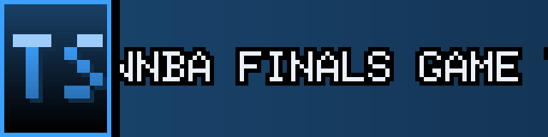
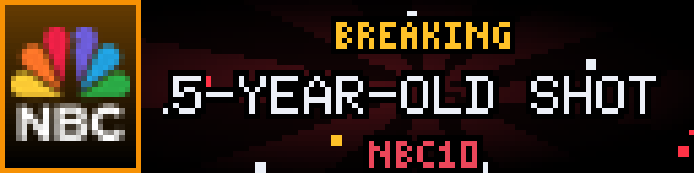
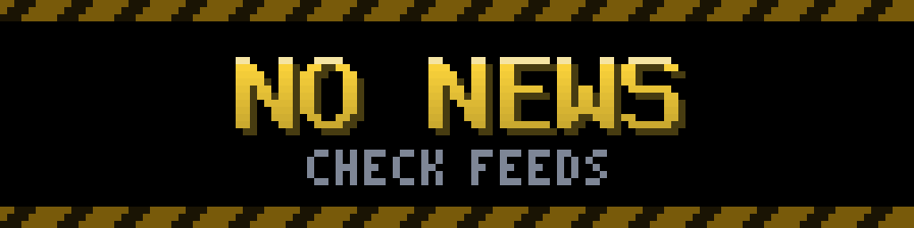

# News Arcade

<!-- hero -->
**Your news feeds, scrolling across the panel like a game's high-score ticker.**

Every headline runs right to left on one continuous strip, in crisp pixel type on a gradient the colour of its feed. Nothing is cut off, and several stories are always on the way. A logo tile on the left (NBC, ESPN, or two-letter initials) follows whichever story is at the edge, so you know the source at a glance.

Feeds are interleaved round-robin, and a brand-new top story takes over the panel with a flashing BREAKING splash that stays up long enough to read it. All fetching happens on a background thread, so the display never waits on the network.

- RSS and Atom, any number of feeds, round-robin
- One continuous ticker: the whole headline always scrolls past, many stories per lap
- Logo tile per feed (PNG) or auto-generated initials
- BREAKING splash for new top stories
- No header, no footer: just the headlines

<p align="center"><br><sub>A feed with its logo</sub></p>
<p align="center"><br><sub>Another feed, another colour</sub></p>
<p align="center"><br><sub>BREAKING alert</sub></p>
<p align="center"><br><sub>Nothing to show</sub></p>

*Screenshots are real frames from the plugin's renderer, shown 6x on a 128x32 panel.*
<!-- /hero -->

RSS headlines for a 128x32 LEDMatrix panel, in the same arcade style as NBA / NFL / NHL Live.

- **Continuous ticker** (`layout: "ticker"`, the default): all stories sit end to end on one long strip and scroll at `crawl_speed` pixels per second. Each starts with a bar in its feed colour, then its text in full. The strip keeps its place between turns, so each time the plugin comes back the ticker carries on where it left off and every story gets seen.
- **Logo tile**: your feed logo, or the feed's initials, changing as each story reaches the left edge.
- **BREAKING burst**: when a feed publishes a story it did not have before, a sunburst interrupts, long enough to read the headline (5 to 14 seconds), then the ticker resumes at that story. The first fetch after a start never bursts.
- **Failure-proof**: a feed that errors keeps its last good headlines on screen.
- **Cards** (`layout: "cards"`): the older one-story-at-a-time screens, where a long headline rests, crawls once and rests again (`min_headline_seconds` / `max_headline_seconds`).
- `update()` does all network calls; `display()` draws from memory.

## Config (`news-arcade` block in config.json)

```json
"news-arcade": {
  "enabled": true,
  "display_duration": 60,
  "headlines_per_feed": 8,
  "feeds": [
    {"name": "LOCAL NEWS", "url": "https://example.com/news/rss.xml", "logo": "assets/plugins/news/uploads/nbc.png"},
    {"name": "TOP SPORTS", "url": "https://www.espn.com/espn/rss/news", "color": [60, 160, 255]}
  ]
}
```

Per feed: `name`, `url`, optional `color` `[r,g,b]`, optional `logo` (absolute, or relative to the LEDMatrix folder), `enabled`.

Other options (all optional):

| Option | Default | |
| --- | --- | --- |
| `layout` | `ticker` | `ticker` or `cards` |
| `title_font` | `6x10` | `5x8`, `6x10`, `7x13B`, `8x13B`, `MatrixChunky8`, `3x5`. Smaller faces fit more headlines per lap |
| `crawl_speed` | 45 | pixels per second |
| `headlines_per_feed` | 5 | newest stories taken from each feed |
| `max_age_hours` | 48 | drop older stories |
| `show_logos` | true | tile on the left; off gives the headlines the full width |
| `breaking_alerts` | true | |
| `display_duration` | 45 | seconds per turn; the ticker carries on at the next one |
| `update_interval` | 300 | seconds between refreshes |
| `request_timeout` | 8 | |
| `min_headline_seconds`, `max_headline_seconds` | 6, 20 | cards layout only |

Display mode: `news_arcade`. It replaces the `news` plugin; turn that one off so the two do not both show headlines.

## Files

`manager.py` plugin · `newsarc_feeds.py` fetch/parse (RSS 2.0 and Atom) · `newsarc_render.py` screens and the ticker strip · `newsarc_draw.py`, `newsarc_font.py` the shared arcade kit · `bdf_face.py` BDF loader · `test_news_arcade.py` offline tests (`python -m pytest test_news_arcade.py`).
