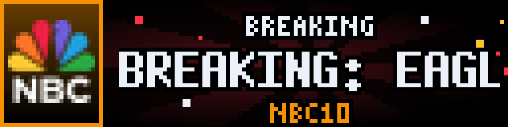
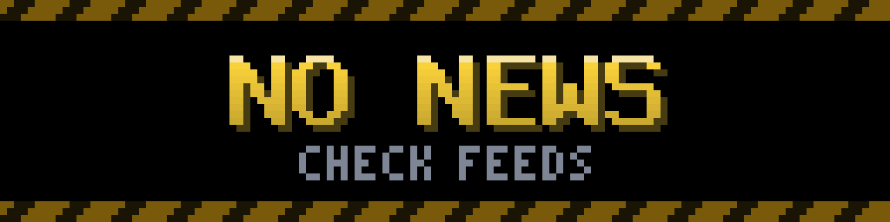

# News Arcade

<!-- hero -->
**Your news feeds, crawling across the panel like a game's high-score ticker.**

One headline at a time, full height, in big smooth pixel type on a gradient the colour of the feed. Long headlines rest, crawl to the end once, then rest again, so you can always read the whole thing. Each feed gets its own logo tile (NBC, ESPN, or two-letter initials) so you know the source at a glance.

Feeds are interleaved round-robin, and a story that matches your breaking-news rules takes over the panel with a flashing BREAKING splash. All fetching happens on a background thread, so the display never waits on the network.

- RSS and Atom, any number of feeds, round-robin
- Logo tile per feed (PNG) or auto-generated initials
- Single-pass crawl that always lets you finish the headline
- BREAKING splash for urgent stories
- No header, no footer: just the headline

<p align="center"><br><sub>A feed with its logo</sub></p>
<p align="center"><br><sub>Another feed, another colour</sub></p>
<p align="center"><br><sub>BREAKING alert</sub></p>
<p align="center"><br><sub>Nothing to show</sub></p>

*Screenshots are real frames from the plugin's renderer, shown 8x on a 128x32 panel.*
<!-- /hero -->

RSS headlines for a 128x32 LEDMatrix panel, in the same arcade style as NBA / NFL / NHL Live.

- **One story at a time**, feeds interleaved round-robin.
- **Headline row**: gradient in the feed colour, smooth BDF face. A headline wider than the row rests, crawls to its end once, rests again, so it is always read in full. The story stays up exactly that long (between `min_headline_seconds` and `max_headline_seconds`).
- **Header band**: status light, feed name, position (`3/12`). Under the headline: how old the story is, then its summary. A segmented bar at the bottom times the story.
- **Tile**: your feed logo, or the feed's initials.
- **BREAKING burst**: when a feed publishes a story it did not have before, a sunburst interrupts for 5 seconds, then that story joins the rotation. The first fetch after a start never bursts.
- **Failure-proof**: a feed that errors keeps its last good headlines on screen.
- `update()` does all network calls; `display()` draws from memory.

## Config (`news-arcade` block in config.json)

```json
"news-arcade": {
  "enabled": true,
  "display_duration": 45,
  "feeds": [
    {"name": "LOCAL NEWS", "url": "https://example.com/news/rss.xml", "logo": "assets/plugins/news/uploads/nbc.png"},
    {"name": "TOP SPORTS", "url": "https://www.espn.com/espn/rss/news", "color": [60, 160, 255]}
  ]
}
```

Per feed: `name`, `url`, optional `color` `[r,g,b]`, optional `logo` (absolute, or relative to the LEDMatrix folder), `enabled`.
Other options (all optional): `headlines_per_feed` (5), `max_age_hours` (48), `min_headline_seconds` (6), `max_headline_seconds` (20), `crawl_speed` (36 px/s), `show_logos`, `breaking_alerts`, `title_font` (7x13B / 8x13B / 6x10 / MatrixChunky8 / 3x5), `update_interval` (300), `request_timeout` (8).

Display mode: `news_arcade`. It replaces the `news` plugin; turn that one off so the two do not both show headlines.

## Files

`manager.py` plugin · `newsarc_feeds.py` fetch/parse (RSS 2.0 and Atom) · `newsarc_render.py` screens · `newsarc_draw.py`, `newsarc_font.py` the shared arcade kit · `bdf_face.py` BDF loader.
