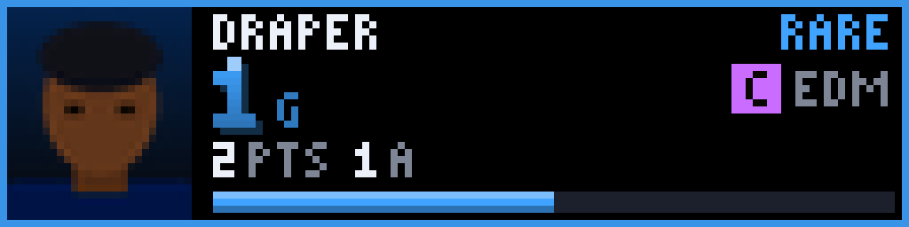
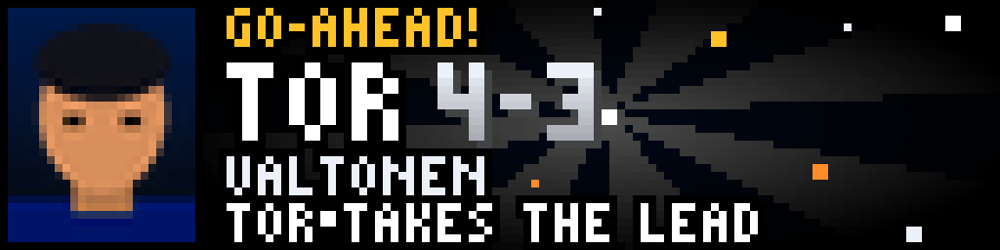
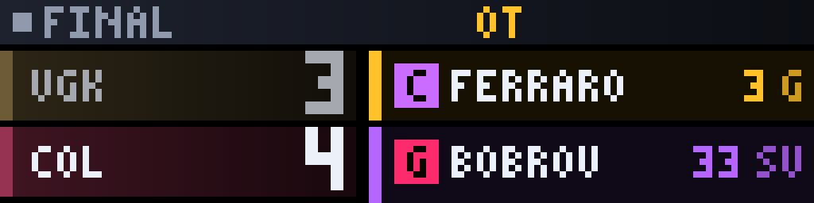
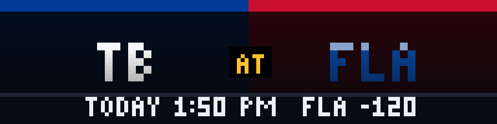

# NHL Live Ice

<!-- hero -->
**NHL night, on a scoreboard that looks like the arena's.**

An LED arena scoreboard with a glowing clock, shots on goal and power-play flags, plus collectible trading-card player cards with headshots, rarity tiers (COMMON to LEGENDARY) and the stat line of the night. Every goal fires a GO-AHEAD! or GOAL burst with the scorer's face. Recent games show the final with the top performers; upcoming games show a matchup preview with the line.

Live, recent and upcoming are separate rotations. Favourite teams can be locked in, and the CLUTCH tag appears late in close games.

- Live scoreboard with period clock, shots and power play
- Player cards with headshots, rarity and stat lines
- Goal bursts
- Final score with top performers
- Upcoming matchups with the line
- Favourite teams and lock-to-favourites

<p align="center"><br><sub>Live scoreboard</sub></p>
<p align="center"><br><sub>Player card</sub></p>
<p align="center"><br><sub>Goal burst</sub></p>
<p align="center"><br><sub>Final</sub></p>
<p align="center"><br><sub>Upcoming matchup</sub></p>

*Screenshots are real frames from the plugin's renderer, shown 8x on a 128x32 panel.*
<!-- /hero -->

An arcade-style NHL show for your LED scoreboard, built like Fantasy Blitz and
its siblings NFL Live Field and NBA Live Court: an arena scoreboard with LED digits and
period-by-period scores, collectible player cards with real headshots, and a burst for every
goal -- for **live**, **recent** (final score) and **upcoming** (matchup
preview) games, each its own rotation. A **favorites lock** limits all three to
your teams. No login or API key.

## The screens

| Screen | What it shows | When |
|--------|---------------|------|
| **Scoreboard** | Score rows in each team's colors and the goals each team scored in every period (`1 2 3 OT SO`) on the left; on the right a blue arena scoreboard in the style of the ones that hang over a rink: the **game clock in red LED dots** (tenths of a second under a minute), the **period in amber**, **shots on goal** for each team either side of **your logo**, and the last play along the bottom when ESPN has one. During a **power play** the logo box's border blinks gold. Between periods the clock reads `INT`; in a shootout, `SO`. **CLUTCH** flashes in the header in overtime, a shootout, or the last five minutes of a one-goal third period. A flame sits on a team's score while it is on a run of 3+ unanswered goals | One per live game |
| **Player card** | A game leader as a trading card: ESPN headshot, name, position tag (`C LW RW D G`), count-up stat, the rest of the stat line (`4 PTS 1 A`) and an XP bar filling toward the next rarity. The frame color is the rarity: gold (Legendary), purple (Epic), blue (Rare). A player who leads several categories is **one** card, headlined by his best stat, with a `HAT TRICK`, `MULTI-GOAL` or `PLAYMAKER` badge when the numbers ESPN names earn it | After each game's scoreboard screen, `cards_per_game` of them |
| **Burst** | A spinning sunburst in the team's colors, confetti, the team, the new score and what the goal did. It interrupts the rotation for a few seconds | **Every goal**: `GOAL` (`TOR SCORES`), `GO-AHEAD` (`TOR TAKES THE LEAD`), `EQUALIZER` (`TOR TIES IT UP`) or `OT WINNER` (`TOR WINS IT`) |

Hockey is low-scoring, so unlike the basketball plugin every goal gets a burst.
For a favorite whose game turns into a shootout, turn on **Only goals that
matter** (`alert_lead_changes_only`) to keep just the go-ahead goals,
equalizers and overtime winners. After a burst the scoring team's row keeps
pulsing on the scoreboard screen for a few seconds.

### Rarity

| | Legendary (gold) | Epic (purple) | Rare (blue) |
|-|------------------|---------------|-------------|
| Goals | 3+ (hat trick) | 2 | 1 |
| Assists | 4+ | 3 | 2 |
| Points | 5+ | 4 | 3 |
| Goalie saves | 40+ | 32+ | 25+ |

Anything lower is Common (white). Rarity rises during a game as the numbers do.

## Live, recent and upcoming

Three display modes, so the plugin fits into your rotation as three entries --
disable the ones you don't want from the plugin's mode list in the web UI,
independent of `show_recent` / `show_upcoming`.

| Mode | Shows | Screens |
|------|-------|---------|
| **Live** (`nhl_live`) | Games in progress, including intermissions | Scoreboard, player cards, bursts |
| **Recent** (`nhl_recent`) | Finished games (`FINAL/OT`, `FINAL/SO` when they went long) | Score rows (the loser dimmed) + an animated stat-leader ticker where the clock board would be, period scores, plus player cards |
| **Upcoming** (`nhl_upcoming`) | Games that haven't started | Matchup, records (`W-L-OTL`), puck-drop time (`TODAY 7:00 PM`, `TMRW 1:00 PM`) and the line when ESPN has one |

## Favorites and the lock

* `favorite_teams` -- pick teams in the web UI (ESPN's abbreviations: `LA`, `NJ`,
  `SJ`, `TB`, `VGK`, `UTAH`, `WSH`, `MTL`...). Typed spellings like `LAK`, `NJD`,
  `SJS`, `TBL`, `WAS` are folded in. Favorites' games come first, get extra turns
  (`favorite_live_boost` live, `game_limits.favorite_rotation_boost` for
  recent/upcoming), and their players' cards lead.
* `lock_to_favorites` -- show **only** games involving a favorite, in every mode.
  If none of your teams is playing, the plugin shows nothing and the display
  moves straight on. `lock_fallback_to_all` shows every other live game until a
  favorite drops the puck.
* `exclude_teams` -- never show these teams anywhere (spoiler protection). Beats
  favorites and the lock.
* `spoiler_delay_seconds` -- hold everything back this many seconds, to match a
  delayed broadcast.

With no favorites chosen, every live game shows.

## Your logo on the scoreboard

The box in the middle of the scoreboard shows a logo of your choice -- the shop,
a team, a sponsor, anything. Use a PNG (a transparent background looks best; it
is scaled to fit and cropped to its artwork). Two ways:

```bash
# 1. the easy way: name it logo.png and drop it in the plugin folder
scp ~/Downloads/mylogo.png pi@raspberrypi.local:~/LEDMatrix/plugin-repos/nhl-live-ice/logo.png

# 2. or keep it anywhere and point the setting "Scoreboard logo" at it (web UI),
#    e.g. /home/pi/logos/logo.png
```

A new or replaced file shows up at the next screen, no restart. With nothing
set, the NHL shield is used. Simple, bold logos read best at this size (the box
is about 24 x 16 pixels on a 128x64 panel and 17 x 12 on a 128x32).

## Install on the Pi

```bash
cd ~/LEDMatrix/plugin-repos
unzip -o ~/nhl-live-ice.zip          # creates nhl-live-ice/
cd ~/LEDMatrix && pip install --break-system-packages -r plugin-repos/nhl-live-ice/requirements.txt
sudo systemctl restart ledmatrix
```

Then open the web UI, enable **NHL Live Ice**, pick your teams, and add
`nhl_live`, `nhl_recent` and `nhl_upcoming` to your rotation.

To see the look without waiting for a game, set **Advanced > Test mode**: six
made-up games (made-up players too), including a Maple Leafs three-goal swing
and go-ahead goal every few updates, with no network use.

## How it gets its data

ESPN's public scoreboard, one request per day: **yesterday** (recent finals),
**today** and **tomorrow** (upcoming), in US Eastern -- ESPN rejects date ranges.
Today is refreshed every `advanced.live_poll_seconds` (30) while a game is on
or about to start, every `idle_poll_seconds` (600) otherwise; yesterday and
tomorrow every 15 minutes (yesterday every 30 seconds while one of its games is
still going). Turning off `show_recent` or `show_upcoming` skips that day's
request. Player headshots come from ESPN too, a few per update, stored in the
plugin cache (not on disk).

If a fetch fails the last good copy is used, so a network blip never blanks the
display. `get_info()` (and the web UI's plugin info) shows `last_error`.

### What is real and what is decoration

* Real: everything on the scoreboard -- scores, period, clock, period scores,
  records, the line, power play, leaders, the last play when ESPN supplies one,
  shots on goal (ESPN's team total, or worked out from the other goalie's
  saves and save percentage), and the run (counted between updates).
* Not shown: penalty clocks. ESPN's scoreboard says only *that* a power play
  is on, not who is serving what or for how long, so the board's penalty boxes
  show shots on goal instead and the PP lamp stands in for the penalty.
* A run is counted from update to update, so goals traded inside one 30-second
  window show as the net margin. A restart or a long outage resets runs and
  queues no bursts.
* Finished games carry their leaders only at game level, one per category; the
  plugin routes each to the right team, so a recent game shows up to a handful
  of cards.

## Panel sizes

Designed at 128x64 and 128x32 and checked at 64x32, 64x64, 96x48, 128x96,
192x64, 256x32 and 256x128. Narrow panels (under 96 px) stack the score rows;
wide ones (192+) put a player card beside the scoreboard; very large ones draw the
128x64 design at 2x.

## All settings

| Setting | Default | |
|---------|---------|-|
| `favorite_teams` | none | Teams to favor |
| `lock_to_favorites` / `lock_fallback_to_all` | off / off | See above |
| `live_game_duration` | 12 s | Scoreboard screen, per live game |
| `cards_per_game` / `card_seconds` | 2 / 6 s | Player cards after each scoreboard screen |
| `favorite_live_boost` | 2 | Turns a favorite's live game gets per lap |
| `live_priority` | on | Let a live game take over the rotation |
| `show_headshots` | on | Off draws a jersey-number silhouette instead |
| `scoreboard_logo` | blank | PNG for the scoreboard's logo box (blank = `logo.png` in the plugin folder, else the NHL shield) |
| `score_alerts` | on | Goal bursts on or off |
| `alert_lead_changes_only` | off | Burst only for go-ahead goals, equalizers and overtime winners |
| `celebrate_all_teams` | off | Bursts for every team, not just favorites |
| `show_recent` / `recent_game_duration` / `recent_cards_per_game` | on / 10 s / 1 | Recent mode |
| `show_upcoming` / `upcoming_game_duration` | on / 8 s | Upcoming mode |
| `game_limits.*` | see UI | How many favorite / other recent and upcoming games, how often the "other" slice rotates |
| `spoiler_delay_seconds` / `exclude_teams` | 0 / none | Spoiler protection |
| `advanced.*` | | Poll rates, timeout, burst length, animation on/off and FPS, photo downloads, test mode |

## Troubleshooting

* **Nothing shows:** with the lock on and none of your teams playing, that is
  correct. Check `last_error` in the plugin info; with the lock off, any live
  game should show.
* **Cards but no photos:** photos arrive over the first few updates (at most
  four per update). Check `show_headshots` and `advanced.headshot_downloads`.
* **No cards at all on a game:** ESPN sometimes leaves leaders out for a few
  minutes around the opening faceoff and after the final horn; the scoreboard screen
  still shows. If cards are missing on every game, ESPN may name its hockey
  leader groups differently than expected -- the plugin accepts `goals`,
  `assists`, `points` and `saves` (with or without `PerGame`/`Leader`); send the
  `leaders` part of a scoreboard response to have another name added.
* **No `PP` or shots line:** ESPN only sends a power-play flag and team shot
  statistics while a game is on, and not for every game.
* **Logs:** `journalctl -u ledmatrix -f | grep -i "NHL"`.

## Development

```bash
pip install --break-system-packages pytest Pillow requests
python -m pytest -q          # 240+ tests: model, data, render, plugin
```

The tests run from a bare checkout (a stub stands in for the core's
`BasePlugin`). Module names are prefixed `nhllive_` so they can't collide with
other plugins loaded in the same process.

## License

GPL-3.0, like the rest of LEDMatrix.
