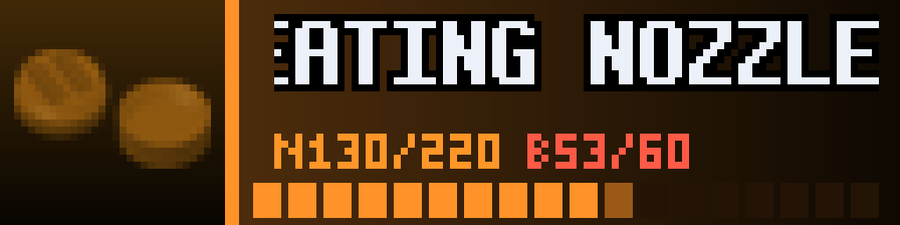
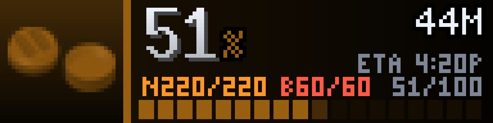
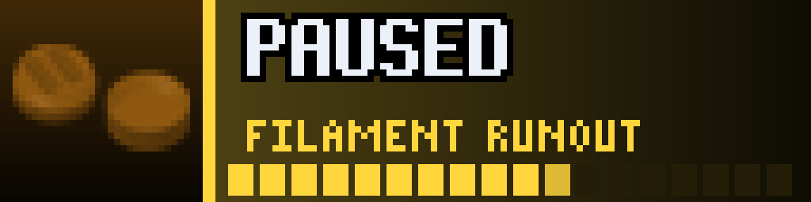
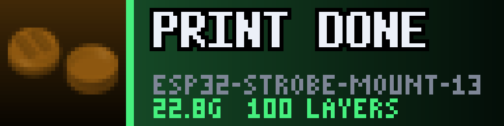
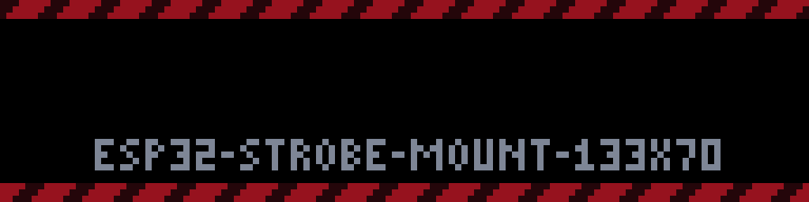

# Print Monitor (arcade)

<!-- hero -->
**A progress screen for your 3D printer that you can read from across the room.**

Start a print on your Bambu Lab printer and the panel wakes up: the job's cover image on the left, a huge percentage, time remaining and the ETA clock, nozzle and bed temperatures, layer count, and a progress gauge in the actual filament colour. Pause for a filament run-out and it tells you why. When the print finishes, confetti.

It polls Home Assistant with a single template call, shows itself only while there is something worth showing, and can interrupt the rotation the moment a job finishes or fails.

- PREPARING, PRINTING, PAUSED, DONE and FAILED screens
- Cover image, percent, time left, ETA, temps and layers
- Gauge in the filament's own colour
- DONE burst with confetti, then a summary card with grams and layers
- Skips itself when the printer is idle
- Built-in `test_mode` demo job

<p align="center"><br><sub>Heating the nozzle</sub></p>
<p align="center"><br><sub>Printing</sub></p>
<p align="center"><br><sub>Paused: filament run-out</sub></p>
<p align="center"><br><sub>Done!</sub></p>
<p align="center"><br><sub>The summary card</sub></p>
<p align="center"><br><sub>Failed</sub></p>

*Screenshots are real frames from the plugin's renderer, shown 8x on a 128x32 panel.*
<!-- /hero -->

3D print status for a Bambu Lab printer on a 128x32 LEDMatrix panel, through Home Assistant's **Bambu Lab** integration.

| State | What the panel shows |
|-------|----------------------|
| **Printing** | The model's thumbnail, a big percent, time left and ETA, nozzle and bed temperatures (`N215/220 B60/60`), the layer count and a segmented gauge in the **filament colour** (the active AMS tray's colour, lifted so black or brown still glows). |
| **Preparing** | The stage in big letters (HEATING NOZZLE, LEVELING BED, LOADING FILAMENT, ...) and a nozzle heat gauge. |
| **Paused** | Amber and blinking, with the reason (FILAMENT RUNOUT, NOZZLE CLOG, ...). |
| **Failed** | Hazard stripes and a blinking PRINT FAILED. |
| **Done** | A PRINT DONE! sunburst with confetti, then a DONE card (name, weight, layers) for `finished_hold_minutes`. |
| **Idle** | Nothing: `display()` returns False so the rotation moves on. Set `show_idle` for a PRINTER IDLE card instead. |

When a print finishes, fails or pauses, the plugin takes over the panel straight away (`interrupt`, the same on-demand switch `ha-notifications` uses). A printer that is already finished when the plugin starts does not burst.

## How it reads the printer

One call to Home Assistant's template API per poll (every 5 s while active, 30 s when idle) reads `print_status`, `current_stage`, `print_progress`, `remaining_time`, `current_layer`, `total_layer_count`, `task_name`, the nozzle and bed temperatures and targets, `print_weight`, `print_error`, `online`, the active AMS tray colour and the cover image. The thumbnail is fetched from `image.<prefix>_cover_image` once per print.

## Setup

Needs the Bambu Lab integration in Home Assistant. `printer_prefix` is the shared part of the entity names: for `sensor.p1s_YOURSERIAL_print_status` it is `p1s_YOURSERIAL`.

```json
"print-monitor": {
  "enabled": true,
  "display_duration": 15,
  "ha_url": "http://homeassistant.local:8123",
  "ha_token": "your-long-lived-token",
  "printer_prefix": "p1s_YOURSERIAL"
}
```

Display mode: `print_monitor`.

Files: `manager.py` (plugin and polling thread), `printmon_data.py` (the HA call, status logic, labels), `printmon_render.py` (screens), `printmon_draw.py` / `printmon_font.py` (shared arcade kit), `bdf_face.py` (BDF fonts).
