# Sky Weather

<!-- hero -->
**A weather display that follows the sky: real sunrises, sunsets and the Moon.**

The backdrop is the actual sky over your house. It runs from deep night through a pink dawn, a blue day and an orange golden hour to a violet dusk, coloured by where the sun really is. The sun rides an arc between today's sunrise and sunset, and the Moon rides its own, with its true phase, its maria and the tilt it has from your latitude: an evening crescent leans toward the sunset.

Clouds drift faster in wind and thicken with cloud cover, rain and snow fall, fog hazes the sky, and thunderstorms flash. Pages show sunrise and sunset with a countdown, the Moon with the next full or new date, hourly columns tinted with the sky colour of each hour, a five-day forecast, and wind, humidity, UV and rain tiles. When the National Weather Service issues an alert for your area, it gets its own page at the front of the rotation and a pulsing warning triangle on the main screen.

Everything comes from Home Assistant (a weather entity, its forecast service and the NWS alerts sensor), so there are no API keys to manage. Sunrise and the Moon are computed locally for your location, and drawing never waits on the network.

- Sky colour from the real sun elevation: night, dawn, day, golden hour, dusk
- Sun and Moon on their real rise-to-set arcs, with sunrise and sunset countdowns
- True Moon phase, tilt and maria for your latitude, plus next moonrise and the next full or new Moon
- Clouds, rain, snow, fog, hail and lightning from the live conditions
- Hourly columns tinted with each hour's sky, daily forecast, wind / humidity / UV / rain tiles
- A page per active NWS alert, most severe first, with a warning badge on the main screen
- Works with any Home Assistant weather entity; no extra API keys
- Built-in `test_mode` time-lapse of a whole day

<p align="center">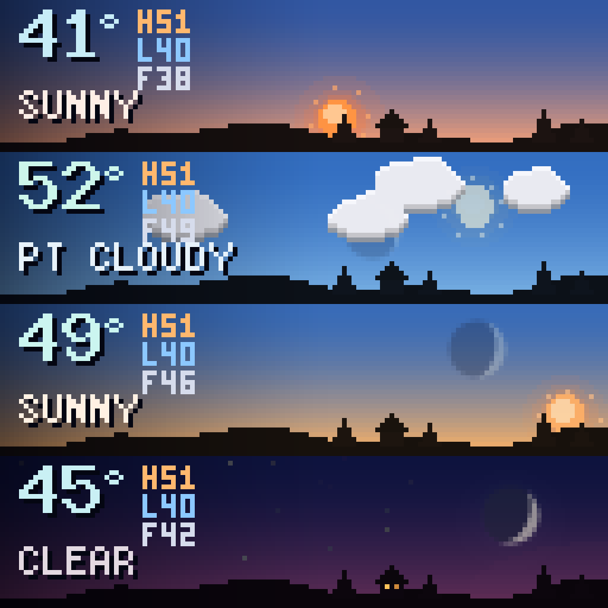<br><sub>One day: sunrise, midday, golden hour and dusk</sub></p>
<p align="center">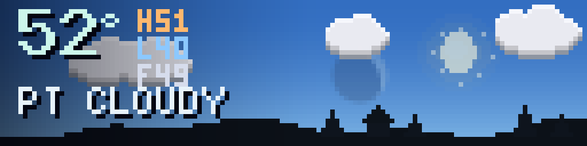<br><sub>Partly cloudy at midday</sub></p>
<p align="center">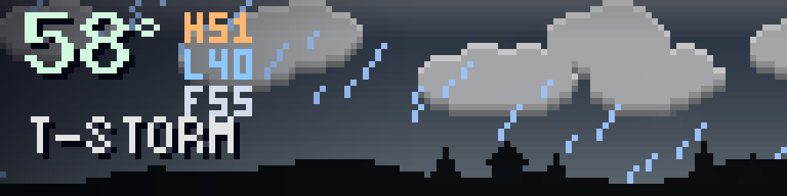<br><sub>Thunderstorm</sub></p>
<p align="center">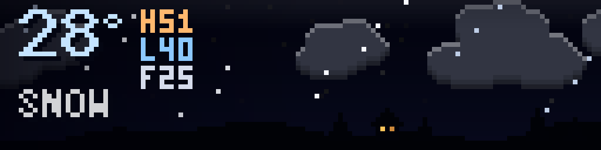<br><sub>Snow at night</sub></p>
<p align="center">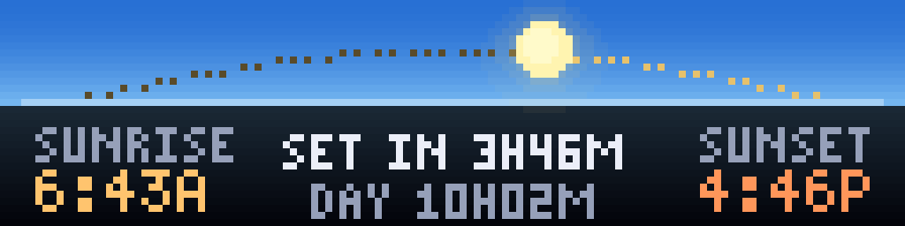<br><sub>Sunrise, sunset and the countdown</sub></p>
<p align="center">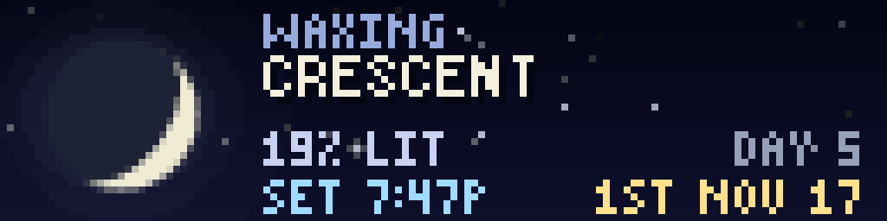<br><sub>The Moon: phase, tilt and the next full Moon</sub></p>
<p align="center">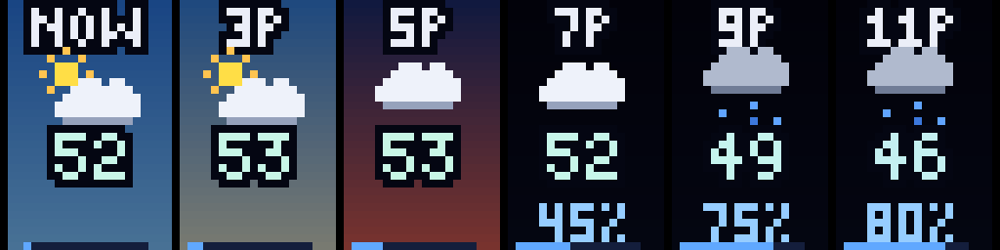<br><sub>Hourly, tinted by the sky of each hour</sub></p>
<p align="center">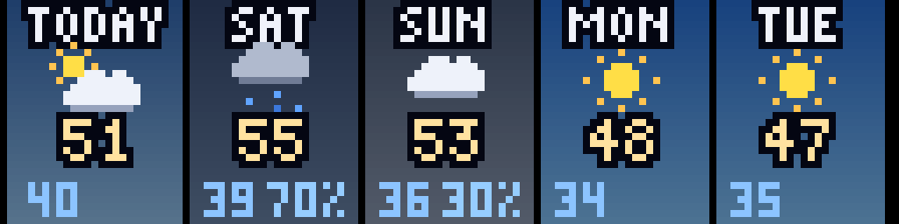<br><sub>Five-day forecast</sub></p>
<p align="center">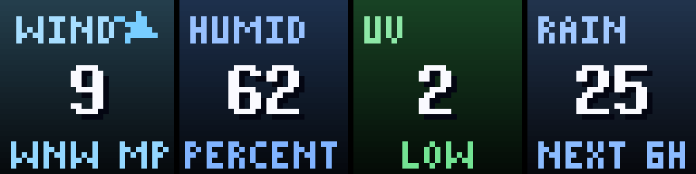<br><sub>Wind, humidity, UV and rain</sub></p>
<p align="center">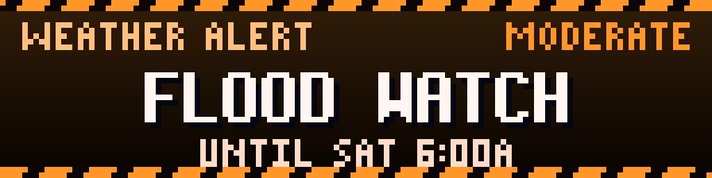<br><sub>A National Weather Service alert</sub></p>
<p align="center">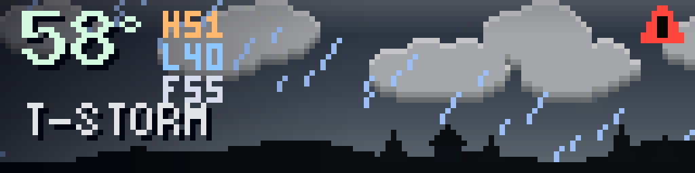<br><sub>The warning badge on the main screen</sub></p>

*Screenshots are real frames from the plugin's renderer, shown 8x on a 128x32 panel.*
<!-- /hero -->

A weather display for a 128x32 LEDMatrix panel that follows the sky. The backdrop is coloured by where the real sun is (night, dawn, blue day, golden hour, dusk), the sun and Moon ride arcs across it, the Moon shows its true phase and tilt for your location, and the clouds, rain, snow, fog and lightning come from the current conditions. Everything is read from Home Assistant, so there are no extra API keys.

## Pages

Pages take turns every `page_seconds`. Active weather alerts get their own pages at the front of the rotation.

| page | shows |
|------|-------|
| `now` | The live sky: temperature, today's high and low, what it feels like, the condition, and the sun or Moon where they really are. A pulsing warning triangle appears in the corner while an alert is active |
| `sun` | Today's sun arc with a dotted path, sunrise and sunset times, a countdown to the next one, daylight length, and GOLDEN HOUR when it is |
| `moon` | A big Moon with its real phase, tilt and maria, phase name, percent lit, day of the cycle, next moonrise or moonset, and the next new, quarter or full Moon |
| `hourly` | Six columns, each tinted with the sky colour of that hour, with an icon, temperature and chance of rain |
| `daily` | Five days with icon, high, low and chance of rain |
| `details` | Four tiles: wind (with a direction arrow), humidity, UV, chance of rain. `feels`, `pressure`, `dew` and `visibility` are available too |
| alert | One page per active National Weather Service alert: severity colour, the event name (a marquee when it is long), and when it ends |

## How the sky works

* **Colour.** The sky gradient is chosen from the sun's elevation, computed locally for your latitude and longitude: deep night, a purple-pink glow before sunrise, blue day, an orange golden hour and a violet dusk. Mornings run pinker than evenings. Overcast, rain and storms pull the colours toward grey.
* **Sun.** It rides an arc from today's real sunrise to today's real sunset (checked against Home Assistant's own times to within a minute). The arc is taller in summer than in winter. Rays twinkle, and cloud dims it to a white disc.
* **Moon.** Phase and illumination are computed from the Moon's position, so the lit shape is the real one, and it is tilted the way it looks from your latitude: an evening crescent leans toward the sunset. It rides its own rise-to-set arc and shows faintly in the daytime sky when it is up. Rise and set times are for your location.
* **Weather.** Cloud cover drives how many clouds drift (faster in wind), rain and snow fall, fog hazes the whole sky, hail bounces, and thunderstorms flash. Small houses on the horizon light a window at night.

## Alerts

Active alerts come from the Home Assistant `nws_alerts` integration (the sensor's `Alerts` attribute). Each one gets a page, most severe first: red for Extreme and Severe, orange for Moderate, yellow for Minor. Expired alerts are dropped. Set `interrupt_alerts` to make a *new* alert take over the panel instead of waiting for its turn (off by default, because `ha-notifications` can already do that through MQTT).

## Setup

```json
"sky-weather": {
  "enabled": true,
  "display_duration": 45,
  "ha_url": "http://homeassistant.local:8123",
  "ha_token": "your-long-lived-token",
  "weather_entity": "weather.openweathermap",
  "alerts_entity": "sensor.nws_alerts_alerts"
}
```

* `weather_entity` can be any Home Assistant weather entity that supports hourly and daily forecasts (Open-Meteo, OpenWeatherMap, Met.no, NWS, ...).
* Sunrise, sunset and the Moon use Home Assistant's own latitude, longitude and time zone. Override them with `latitude`, `longitude` and `timezone` if you prefer.
* `pages` sets which pages show and in what order, for example `["now", "moon"]`.
* One request per `poll_seconds` (60) reads conditions and alerts; the forecast is refreshed every `forecast_seconds` (600). Drawing only reads from memory, so the panel never waits on the network. If Home Assistant goes quiet the last values stay up, and after ten minutes a NO WEATHER DATA screen takes over.

`test_mode: true` plays a made-up day: a 30-second time-lapse of the sky (clear dawn, clouds, a thunderstorm, a golden sunset, the Moon coming up), then every page and two alerts. Turn it off afterwards. Display mode: `sky_weather`.

Files: `manager.py` (plugin and polling thread), `sky_data.py` (Home Assistant calls and parsing), `sky_astro.py` (sun, Moon and phase maths), `sky_render.py` (the sky and every page), `sky_draw.py` / `sky_font.py` (drawing kit), `bdf_face.py` (BDF fonts). Tests: `test_sky.py`.
